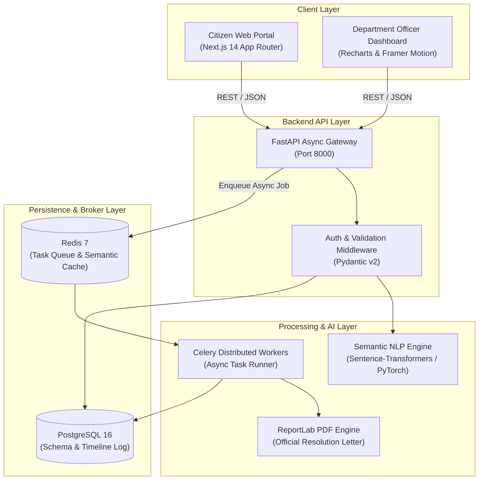

# 🏛️ System Architecture - Grievance360

This document defines the high-level architecture, data pipeline, and asynchronous task execution model of the Grievance360 platform.

---

## 📐 Architecture Diagram

---

## 🔄 Grievance Lifecycle & AI Pipeline

1. **Intake**: Citizen submits grievance via Next.js form with attachments and location data.
2. **Semantic Embedding**: FastAPI passes textual description to `sentence-transformers` to generate a 384-dimensional embedding vector.
3. **Duplicate Detection**: Cosine similarity check against recent complaints in the same ward/category. If similarity > 0.88, flags ticket as a likely duplicate.
4. **Automated Triage & Routing**: Priority (Low/Medium/High/Critical) and department are predicted based on learned classifier heuristics.
5. **SLA Timers**: Celery schedules periodic SLA tick events. If resolution exceeds `default_sla_hours`, automated escalation alerts are sent to the department head.
6. **Resolution & Certificate**: Upon officer sign-off, ReportLab compiles an official digitally timestamped resolution notice PDF.
